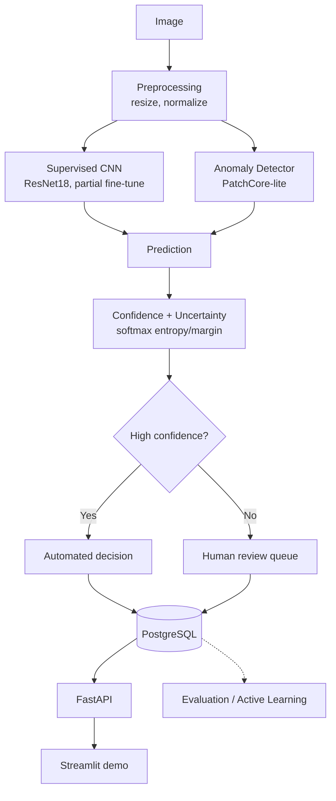

# DefectVisionAI

Industrial surface-defect inspection system: a classical baseline vs. a supervised
classifier vs. a PatchCore-style anomaly detector, with calibrated uncertainty
deciding when to defer to a human, an active-learning simulation testing whether
smarter sampling cuts labeling cost, and a FastAPI + PostgreSQL backend with a
human-review workflow. Every number below is generated by a script in this repo, and
every limitation is stated rather than hidden.

## Demo

```bash
API_URL=http://localhost:8020 streamlit run demo/app.py
```

A thin Streamlit UI that calls the FastAPI backend over HTTP — the API remains the
primary interface, not a parallel prediction path.


| Normal part | Defective part (flagged for review) |
|---|---|
|  |  |

The human-review workflow itself, via the API's `/docs` Swagger UI:


## Architecture



## Dataset

**MVTec AD — `metal_nut` category** (335 images: 220 normal train + 115 test = 22
good, 93 anomalous across `bent`/`color`/`flip`/`scratch`, each with a pixel-level
mask). Third-party HF mirror of the official dataset, CC BY-NC-SA 4.0. **Not
automotive production data** — `metal_nut` is used as the closest available domain
analog to automotive hardware inspection; see [`data/README.md`](data/README.md) for
full provenance and why the supervised/active-learning track uses its own 80/35
split of the labeled pool, separate from the anomaly detector's official 220/115
protocol split.

## Key Results

Generated by `scripts/train_anomaly.py`, `train.py`, `evaluate.py`,
`run_active_learning.py` → `reports/metrics/*.json`. Full report:
[`reports/evaluation_report.md`](reports/evaluation_report.md).

| Model | Image AUROC | Image AUPRC | Pixel AUROC |
|---|---:|---:|---:|
| Classical baseline | 0.577 | 0.872 | N/A |
| PatchCore-lite | 0.944 | 0.987 | 0.953 |

**Supervised classifier** (held-out test, n=35): accuracy 0.800, macro-F1 0.794.

**Calibration**: temperature scaling made ECE *worse* (0.115 → 0.179) — with only 16
validation images the fit likely overfit. A negative result, reported as one.

**Active learning**: random/uncertainty/diversity/hybrid acquisition compared over 5
seeds (`docs/images` for prediction demo, `reports/figures/active_learning_curves.png`
for the curves). Confidence bands overlap for most of the budget range — **this does
not demonstrate a clear labeling-efficiency advantage over random selection**, given
the dataset's small size.

## Tech Stack

- **ML**: PyTorch + torchvision (ResNet18), scikit-learn, scikit-image, OpenCV, Pillow
- **Backend**: FastAPI, Pydantic, Uvicorn
- **Data**: SQLAlchemy + PostgreSQL (SQLite for local dev/tests), YAML-driven configs
- **Infrastructure**: Docker + Docker Compose, GitHub Actions CI
- **Testing**: pytest, ruff, mypy

## Quickstart

```bash
git clone https://github.com/nithya-prakash/DefectVisionAI.git && cd DefectVisionAI
python3.12 -m venv .venv && source .venv/bin/activate   # Python 3.12 -- PyTorch doesn't support 3.14 yet
pip install -e ".[dev]"
python scripts/download_data.py && python scripts/prepare_data.py

# Run the experiments (each writes real metrics to reports/metrics/)
python scripts/train_anomaly.py
python scripts/train.py
python scripts/evaluate.py
python scripts/run_active_learning.py
python scripts/generate_report.py

python scripts/run_inference.py --image path/to/image.png   # single-image CLI inference
uvicorn automotive_vision.api.main:app --reload             # POST /predict, /review, GET /predictions/{id}, /health, /metrics
docker compose up --build                                    # API on :8020, Postgres on :5440
pytest                                                        # 41 tests, ~10s
```

Runs entirely on CPU or Apple Silicon MPS — no GPU or paid API required.

## Limitations

- Benchmark data, not automotive production data (MVTec AD `metal_nut`, a fastener).
- Human labeling in active learning is simulated with ground-truth labels, not live annotation.
- Both the supervised and active-learning tracks train on very small data (80 labeled images / 5 classes) — reported metrics have wide confidence intervals.
- Active learning and temperature scaling both produced negative/inconclusive results here, reported as such.
- PatchCore-lite is a simplified variant (random coreset, k=1 NN), not a reproduction of the original paper.
- Grad-CAM/anomaly heatmaps are correlational, not causal proof of the defect location.
