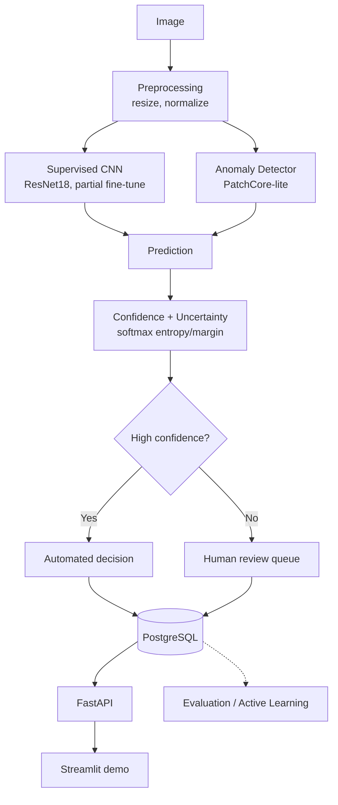

# Automotive Vision Defect Detection + Active Learning

A computer vision system for industrial surface-defect inspection, built with the
engineering practices a real deployment would need: a classical baseline compared
against a supervised classifier and an anomaly detector, calibrated uncertainty that
decides when to defer to a human, an active-learning simulation testing whether
smarter sample selection reduces labeling cost, and all of it served through a
FastAPI + PostgreSQL backend with a human-review workflow — not a single notebook.
Every number in this README is generated by a script in this repo, and every
limitation below is stated rather than hidden.

## Why this project?

Manual visual inspection on a production line is slow and inconsistent, but training
a single "defect / no defect" classifier oversimplifies the real problem: labeled
defect examples are expensive and scarce, a classifier is silently wrong on
out-of-distribution parts, and nobody tells you when to trust it. This project treats
inspection as a system-design problem instead of a single-model problem — comparing
methods, quantifying uncertainty, and testing (not assuming) whether active learning
actually cuts the labeling burden — using automotive hardware (metal fasteners) as
the target application domain.

## Architecture



Code layout mirrors this: `data/` (pipeline), `models/` (classifier, anomaly
detector, embeddings, uncertainty), `training/` (train/eval/calibration loops),
`active_learning/` (acquisition strategies + simulation), `inference/` (predictor,
explainability), `api/` + `database/` (FastAPI + SQLAlchemy).

## Dataset

**MVTec AD — `metal_nut` category**, via a third-party Hugging Face mirror of the
official dataset (CC BY-NC-SA 4.0, non-commercial/research use). Full provenance,
license discussion, and exact verified image counts are in
[`data/README.md`](data/README.md) — summarized here:

```
335 total images: 220 normal (train) + 115 test (22 good, 93 anomalous across
4 defect types: bent, color, flip, scratch), each with a pixel-level ground-truth mask.
```

**No MVTec AD category is literally automotive, and this is not automotive
production data.** `metal_nut` (a metal fastener) is used as an industrial
visual-inspection benchmark and the closest available domain analog to automotive
hardware inspection — that distinction is not glossed over anywhere in this repo.

Because labeled defect examples only exist in the 115-image test folder, the
supervised/active-learning track uses its own stratified split of that pool (80
pool / 35 held-out test), separate from the anomaly detector's official-protocol
split (220 train-normal / 115 test). See `data/README.md` for exactly why.

## Key Results

All figures are read from `reports/metrics/*.json`, generated by the scripts named
below — reproduce with `python scripts/generate_report.py` after running the
corresponding script. Full report: [`reports/evaluation_report.md`](reports/evaluation_report.md).

**Anomaly detection** (official MVTec protocol, n=115 test images):

| Model | Image AUROC | Image AUPRC | Pixel AUROC |
|---|---:|---:|---:|
| Classical baseline | 0.577 | 0.872 | N/A |
| PatchCore-lite | 0.944 | 0.987 | 0.953 |

The classical baseline performs barely above chance (as expected for whole-image
texture histograms), while PatchCore-lite localizes defects well — see
`reports/figures/anomaly_heatmap_examples.png`. 95% bootstrap CIs are in the full
report; with n=115 they are wide (e.g. PatchCore-lite image AUROC: [0.894, 0.981]).

**Supervised classification** (held-out test, n=35, 7 per class): accuracy 0.800,
macro-F1 0.794. Per-class F1 ranges from 1.00 (`flip`) to 0.50 (`bent`, most often
confused with `color`) — see `reports/figures/classifier_confusion_matrix.png`.

## Active Learning Experiment

**This is a simulation**, not a live annotation study: MVTec's ground-truth labels
stand in for a human reviewer, revealed only when the acquisition strategy selects
that sample (`active_learning/simulation.py`). Random, uncertainty, diversity, and
hybrid acquisition were compared over 5 seeds. Compute constraints (4 strategies × 5
seeds × 8 rounds of retraining) meant using frozen ResNet18 embeddings + a
lightweight logistic-regression head rather than fine-tuning the full CNN every
round; the headline classifier numbers above come from the fully fine-tuned model,
not this lightweight head.


Uncertainty sampling shows the well-known "cold-start" pathology (worse than random
early on, when the model is still poor), and all strategies converge once the full
80-image pool is labeled — an expected sanity check, not a finding. Confidence bands
(±1 std over 5 seeds) overlap for most of the budget range. **This experiment does
not demonstrate a statistically clear labeling-efficiency advantage for any
acquisition strategy over random selection**, given the dataset's small size. That's
reported as the result, not hedged into a win — a larger pool would be needed to
resolve whether the mid-budget separation visible in the plot is signal or noise.

## Calibration

Temperature scaling (`training/calibration.py`) was fit on the 16-image validation
set and evaluated on the 35-image held-out test set.

| | ECE |
|---|---:|
| Raw | 0.115 |
| Temperature-scaled (T=0.14) | 0.179 |

**Temperature scaling made calibration worse here, in this experiment.** With only
16 validation examples, the fitted temperature likely overfit — it sharpened
confidence into a narrow high-confidence band that turned out to be less accurate
than its own confidence implied on the test set. This is a known risk of temperature
scaling under small validation sets in general, but the specific explanation here is
an interpretation of this one run, not a universal claim. See
`reports/figures/reliability_diagram.png`.

The human-review confidence threshold (0.7 by default, see `configs/inference.yaml`)
was selected via a threshold sweep (`reports/metrics/calibration.json`) as the
smallest threshold giving ≥90% accuracy on auto-decided predictions in the held-out
test — stated as the selection rule used, not claimed to be provably optimal.

## Tech Stack

- **ML**: PyTorch + torchvision (ResNet18), scikit-learn, scikit-image, OpenCV, Pillow
- **Backend**: FastAPI, Pydantic, Uvicorn
- **Data**: SQLAlchemy + PostgreSQL (SQLite for local dev/tests), YAML-driven configs
- **Infrastructure**: Docker + Docker Compose, GitHub Actions CI
- **Testing**: pytest, ruff, mypy

## Project Structure

```
automotive-vision-inspection/
├── configs/            # YAML configs: base, training, inference, active_learning
├── data/               # dataset docs; raw/processed data is gitignored
├── demo/               # Streamlit UI (calls the API, not a parallel prediction path)
├── docker/             # Dockerfile (training) + Dockerfile.api
├── notebooks/          # executed exploratory analysis notebook
├── reports/            # generated metrics (json), figures (png), evaluation_report.md
├── scripts/            # CLI entry points (download, train, evaluate, run_inference, ...)
├── src/automotive_vision/
│   ├── active_learning/  # acquisition strategies + simulation loop
│   ├── api/              # FastAPI routes, schemas, dependencies
│   ├── data/             # dataset scanning, splitting, preprocessing, augmentation
│   ├── database/         # SQLAlchemy models, session, repository
│   ├── inference/        # Predictor, explainability, postprocessing
│   ├── models/           # classifier, anomaly detector, embeddings, uncertainty
│   ├── training/         # train/eval/calibration loops
│   └── utils/            # config loading, logging, seeding, device resolution
└── tests/              # unit/ + integration/ + test_api.py (41 tests)
```

## Setup

```bash
python3.12 -m venv .venv && source .venv/bin/activate   # Python 3.12 -- PyTorch doesn't support 3.14 yet
pip install -e ".[dev]"
python scripts/download_data.py
python scripts/prepare_data.py
```

## Running Experiments

```bash
python scripts/train_anomaly.py        # classical baseline + PatchCore-lite -> reports/metrics/anomaly_detection.json
python scripts/train.py                # supervised classifier -> reports/metrics/supervised_classification.json
python scripts/evaluate.py             # calibration -> reports/metrics/calibration.json
python scripts/run_active_learning.py  # acquisition comparison -> reports/metrics/active_learning.json
python scripts/generate_report.py      # assembles reports/evaluation_report.md from the above
python scripts/run_inference.py --image path/to/image.png   # single-image CLI inference
```

Runs entirely on CPU or Apple Silicon MPS — no GPU or paid API required. On this
project's M4 MacBook, the full anomaly-detection + classifier + active-learning
pipeline (excluding dataset download) runs in well under two minutes.

## Running the API

```bash
uvicorn automotive_vision.api.main:app --reload
```

Endpoints: `POST /predict`, `POST /predict/batch`, `POST /review`,
`GET /predictions/{id}`, `GET /health`, `GET /metrics`. Manually verified end-to-end
(predict → review → detail → metrics) both locally and against the Dockerized
Postgres backend, including 415/400/404/409 error paths.

## Running with Docker

```bash
docker compose up --build   # API on :8020, Postgres on :5440
```

Both Dockerfiles pin CPU-only PyTorch wheels explicitly (the default Linux wheel
otherwise pulls the full CUDA toolkit for a container that will never have a GPU).

## Running Tests

```bash
pytest
```

41 unit + integration tests: uncertainty math, calibration/ECE, all four acquisition
strategies, dataset splitting, Pydantic schemas, Grad-CAM/anomaly-heatmap
explainability, and a full predict→review→metrics API cycle against a real
SQLite-backed app. The model itself is mocked in API tests
(`tests/fake_predictor.py`) so the suite runs in seconds without a trained
checkpoint. CI (`.github/workflows/ci.yml`) runs this on every push.

## Demo

```bash
API_URL=http://localhost:8020 streamlit run demo/app.py
```

A thin Streamlit UI that calls the FastAPI backend over HTTP — the API remains the
primary interface, not a parallel prediction path.

## Limitations

- **Benchmark data, not automotive production data.** MVTec AD `metal_nut` is a
  fastener, not a car body panel; lighting, camera setup, and defect types in a real
  factory will differ.
- **Human labeling is simulated**, using MVTec's ground-truth labels, not a live
  annotation workflow (see [Active Learning Experiment](#active-learning-experiment)).
- **Both the supervised and active-learning tracks train on very small data** (80
  labeled images across 5 classes), because MVTec AD only labels defect subtypes in
  its test folder. Reported metrics (and their wide confidence intervals) reflect that.
- **Active learning does not demonstrate a clear labeling-efficiency win** in this
  experiment — see the honest reading above.
- **Temperature scaling made calibration worse, not better**, in this experiment.
- **PatchCore-lite is a simplified variant** (random coreset subsampling, k=1 nearest
  neighbor), not a reproduction of the original paper's method or benchmark numbers.
- **Grad-CAM / anomaly heatmaps are correlational**, not causal proof that highlighted
  pixels are the actual defect.
- **Anomaly detection is only as good as how representative the "normal" training
  images are** — a shift in the true normal distribution (new part variant, different
  lighting) would degrade it without warning.

## Future Work

- Extend to a second MVTec category (`screw`) to test whether findings generalize.
- Replace the frozen-embedding active-learning head with periodic full-CNN
  fine-tuning once a larger labeled pool is available, to see if the strategy
  separation seen here holds up.
- A larger validation set for temperature scaling (or cross-validated temperature
  fitting) to test whether calibration actually improves with more data.
- Try MC-dropout uncertainty (already implemented in `models/uncertainty.py`, not yet
  wired into the default inference path) as a second review-routing signal alongside
  softmax entropy, and compare the two.
- If real automotive inspection images become available, evaluate domain transfer
  from this MVTec-trained pipeline.
