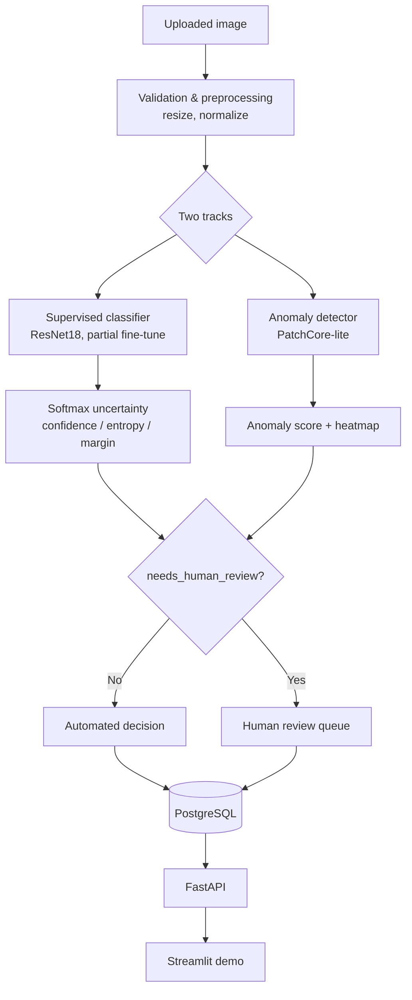

# Automotive Vision Defect Detection + Active Learning

A production-style computer vision system for industrial surface-defect inspection,
built to demonstrate the full ML engineering loop: deep learning, anomaly detection,
uncertainty estimation, active learning, human-in-the-loop review, a REST API with a
real database, Docker deployment, and reproducible evaluation — not a single-notebook
classifier.

**The pitch:** instead of training one image classifier, this project compares a
classical CV baseline, a supervised classifier, and an industrial anomaly detector,
adds calibrated uncertainty so the system knows when to defer to a human, and runs an
active-learning simulation to test whether smarter sample selection actually reduces
the labeling burden. All numbers below come from scripts in this repo — see
[Results](#results) for what was actually measured vs. what remains a hypothesis.

## Table of contents

- [Dataset](#dataset)
- [Architecture](#architecture)
- [ML pipeline](#ml-pipeline)
- [Results](#results)
- [Active learning](#active-learning)
- [Calibration](#calibration)
- [Engineering](#engineering)
- [Getting started](#getting-started)
- [Limitations](#limitations)
- [Future work](#future-work)

## Dataset

**MVTec AD — `metal_nut` category**, via a third-party Hugging Face mirror of the
official dataset (CC BY-NC-SA 4.0, non-commercial/research use). Full provenance,
license discussion, and exact verified image counts are in
[`data/README.md`](data/README.md) — summarized here:

```
335 total images: 220 normal (train) + 115 test (22 good, 93 anomalous across
4 defect types: bent, color, flip, scratch), each with a pixel-level ground-truth mask.
```

**No MVTec AD category is literally automotive.** `metal_nut` (a metal fastener) was
chosen as the closest available analog to automotive hardware inspection. This project
targets automotive manufacturing as its *application domain*; the *benchmark* is
MVTec AD. This distinction matters and is not glossed over anywhere in this README.

Because labeled defect examples only exist in the 115-image test folder, the
supervised/active-learning track uses its own stratified split of that pool (80
pool / 35 held-out test), separate from the anomaly detector's official-protocol split
(220 train-normal / 115 test). See `data/README.md` for why.

## Architecture



Code layout mirrors this: `data/` (pipeline), `models/` (classifier, anomaly
detector, embeddings, uncertainty), `training/` (train/eval/calibration loops),
`active_learning/` (acquisition strategies + simulation), `inference/` (predictor,
explainability), `api/` + `database/` (FastAPI + SQLAlchemy).

## ML pipeline

**Preprocessing.** Deterministic resize + ImageNet normalization
(`src/automotive_vision/data/preprocessing.py`); mild augmentation only at train time
(flip/rotation/color-jitter — aggressive augmentation risks destroying the very
scratches/dents being detected).

**Classical baseline** (`models/classical_baseline.py`): grayscale intensity + LBP
texture + Sobel edge-magnitude histograms, scored by nearest-neighbor distance to a
bank of normal-image features. A deliberately simple reference point, not a
competitive method.

**Supervised classifier** (`models/classifier.py`): ResNet18, ImageNet-pretrained,
partial fine-tune (layer4 + head unfrozen, everything earlier frozen). Chosen over a
larger backbone (EfficientNet/ConvNeXt) specifically because the labeled pool is tiny
(~80 images across 5 classes) — a bigger model would only add overfitting risk without
more data to justify it.

**Anomaly detection** (`models/anomaly_detector.py`): a **simplified PatchCore-style**
detector — frozen ResNet18 mid-level patch embeddings, a memory bank of normal-image
patches, nearest-neighbor distance as the anomaly score. Explicitly simplified vs. the
original paper: uniform random memory-bank subsampling instead of greedy coreset
selection, and single nearest-neighbor (k=1) instead of k-NN re-weighting. Not a
reproduction of the paper's benchmark numbers.

**Uncertainty** (`models/uncertainty.py`): confidence, normalized entropy, and margin
from the softmax output; optional Monte Carlo dropout for a second, independent
uncertainty signal. Thresholds are config, not hard-coded — see
[Calibration](#calibration) for how the review threshold was actually chosen.

**Active learning** (`active_learning/`): random / uncertainty / diversity / hybrid
acquisition strategies, simulated with ground-truth labels standing in for a human
reviewer (see [Active learning](#active-learning)).

**Human review** (`api/routes.py`, `database/models.py`): predictions flagged
`needs_human_review` are queryable and can be resolved via `POST /review`, persisting
the human label alongside the original prediction for later analysis.

## Results

All figures below are read from `reports/metrics/*.json`, generated by the scripts
named in each row — reproduce them with `python scripts/generate_report.py` after
running the corresponding script. Full report:
[`reports/evaluation_report.md`](reports/evaluation_report.md).

### Anomaly detection (official MVTec protocol, n=115 test images)

| Model | Image AUROC | Image AUPRC | Pixel AUROC |
|---|---:|---:|---:|
| Classical baseline | 0.577 | 0.872 | N/A |
| PatchCore-lite | 0.944 | 0.987 | 0.953 |

The classical baseline performs barely above chance (as expected for whole-image
texture histograms), while PatchCore-lite localizes defects well — see
`reports/figures/anomaly_heatmap_examples.png`. 95% bootstrap CIs are in the full
report; with n=115 they are wide (e.g. PatchCore-lite image AUROC: [0.894, 0.981]).

### Supervised classification (held-out test, n=35, 7 per class)

Accuracy 0.800, macro-F1 0.794. Per-class F1 ranges from 1.00 (`flip`) to 0.50
(`bent`, most often confused with `color`) — see the confusion matrix at
`reports/figures/classifier_confusion_matrix.png`.

## Active learning

**This is a simulation**, not a live annotation study: MVTec's ground-truth labels
stand in for a human reviewer, revealed only when the acquisition strategy selects
that sample (`active_learning/simulation.py`). Compute constraints (4 strategies × 5
seeds × 8 rounds of retraining) meant using frozen ResNet18 embeddings + a lightweight
logistic-regression head rather than fine-tuning the full CNN every round; the
headline classifier numbers above come from the fully fine-tuned model, not this
lightweight head.


**Honest reading of this result:** uncertainty sampling shows the well-known
"cold-start" pathology (worse than random early on, when the model is still poor),
and all strategies converge once the full 80-image pool is labeled — an expected
sanity check, not a finding. Confidence bands (±1 std over 5 seeds) overlap for most
of the budget range. **This experiment does not demonstrate a statistically clear
labeling-efficiency advantage for any acquisition strategy over random selection**,
given the dataset's small size. That's a real result, not a hedge — a larger pool
would be needed to resolve whether the mid-budget separation visible in the plot is
signal or noise.

## Calibration

Temperature scaling (`training/calibration.py`) was fit on the 16-image validation
set and evaluated on the 35-image held-out test set.

| | ECE |
|---|---:|
| Raw | 0.115 |
| Temperature-scaled (T=0.14) | 0.179 |

**Temperature scaling made calibration worse here.** With only 16 validation
examples, the fitted temperature overfit — it sharpened confidence into a narrow
high-confidence band that turned out to be less accurate than its own confidence
implied on the test set. This is a known failure mode of temperature scaling under
small validation sets, kept in the report rather than discarded, because it's a real
constraint of this dataset size, not a bug. See
`reports/figures/reliability_diagram.png`.

The human-review confidence threshold (0.7 by default, see `configs/inference.yaml`)
was selected via a threshold sweep (`reports/metrics/calibration.json`) as the
smallest threshold giving ≥90% accuracy on auto-decided predictions in the held-out
test — stated as the selection rule used, not claimed to be provably optimal.

## Engineering

- **FastAPI** (`src/automotive_vision/api/`): `POST /predict`, `POST /predict/batch`,
  `POST /review`, `GET /predictions/{id}`, `GET /health`, `GET /metrics`. Manually
  verified end-to-end (predict → review → detail → metrics), including 415/400/404/409
  error paths.
- **PostgreSQL** via SQLAlchemy (`database/`): images, predictions, reviews, and
  model_versions tables; SQLite is used automatically for local dev/tests
  (`DATABASE_URL` env var switches between them).
- **Docker**: `docker compose up` starts the API + Postgres. Both Dockerfiles pin
  CPU-only PyTorch wheels explicitly (the default Linux wheel otherwise pulls the full
  CUDA toolkit for a container that will never have a GPU).
- **Testing**: 38 pytest unit + integration tests (uncertainty math, calibration/ECE,
  all four acquisition strategies, dataset splitting, Pydantic schemas, and a full
  predict→review→metrics API cycle against a real SQLite-backed app). The model itself
  is mocked in API tests (`tests/fake_predictor.py`) so the suite runs in seconds
  without a trained checkpoint.
- **Experiment tracking**: every script writes its config, seed, and real metrics to
  `reports/metrics/*.json`; `scripts/generate_report.py` assembles them into one
  report, rendering "not yet run" for anything missing rather than a fabricated number.
- **Config-driven**: all hyperparameters live in `configs/*.yaml`, not hard-coded.

## Getting started

```bash
# 1. Environment (Python 3.12 — PyTorch does not yet support 3.14)
python3.12 -m venv .venv && source .venv/bin/activate
pip install -e ".[dev]"

# 2. Data
python scripts/download_data.py
python scripts/prepare_data.py

# 3. Run the experiments (each writes real metrics to reports/metrics/)
python scripts/train_anomaly.py
python scripts/train.py
python scripts/evaluate.py
python scripts/run_active_learning.py
python scripts/generate_report.py

# 4. Single-image inference from the CLI
python scripts/run_inference.py --image path/to/image.png

# 5. API + demo
docker compose up --build         # API on :8020, Postgres on :5440
API_URL=http://localhost:8020 streamlit run demo/app.py   # thin UI on top of the API

# Tests
pytest
```

Runs entirely on CPU or Apple Silicon MPS — no GPU or paid API required. On this
project's M4 MacBook, the full anomaly-detection + classifier + active-learning
pipeline (excluding dataset download) runs in well under two minutes.

## Limitations

- **Benchmark data ≠ automotive factory data.** MVTec AD `metal_nut` is a fastener,
  not a car body panel; lighting, camera setup, and defect types in a real factory
  will differ.
- **Human labeling is simulated**, using MVTec's ground-truth labels, not a live
  annotation workflow (see [Active learning](#active-learning)).
- **Both the supervised and active-learning tracks train on very small data** (80
  labeled images across 5 classes), because MVTec AD only labels defect subtypes in
  its test folder. Reported metrics (and their wide confidence intervals) reflect that.
- **Active learning does not demonstrated a clear labeling-efficiency win** in this
  experiment — see the honest reading above.
- **Temperature scaling overfit** its 16-example validation set and made calibration
  worse, not better, here.
- **PatchCore-lite is a simplified variant** (random coreset subsampling, k=1 nearest
  neighbor), not a reproduction of the original paper's method or benchmark numbers.
- **Grad-CAM / anomaly heatmaps are correlational**, not causal proof that highlighted
  pixels are the actual defect.
- **Anomaly detection is only as good as how representative the "normal" training
  images are** — a shift in the true normal distribution (new part variant, different
  lighting) would degrade it without warning.

## Future work

- Extend to a second MVTec category (`screw`) to test whether findings generalize.
- Replace the frozen-embedding active-learning head with periodic full-CNN
  fine-tuning once a larger labeled pool is available, to see if the strategy
  separation seen here holds up.
- A larger validation set for temperature scaling (or cross-validated temperature
  fitting) to test whether calibration actually improves with more data.
- Try MC-dropout uncertainty (already implemented in `models/uncertainty.py`) as a
  second review-routing signal alongside softmax entropy, and compare the two.
- If real automotive inspection images become available, evaluate domain transfer
  from this MVTec-trained pipeline.
