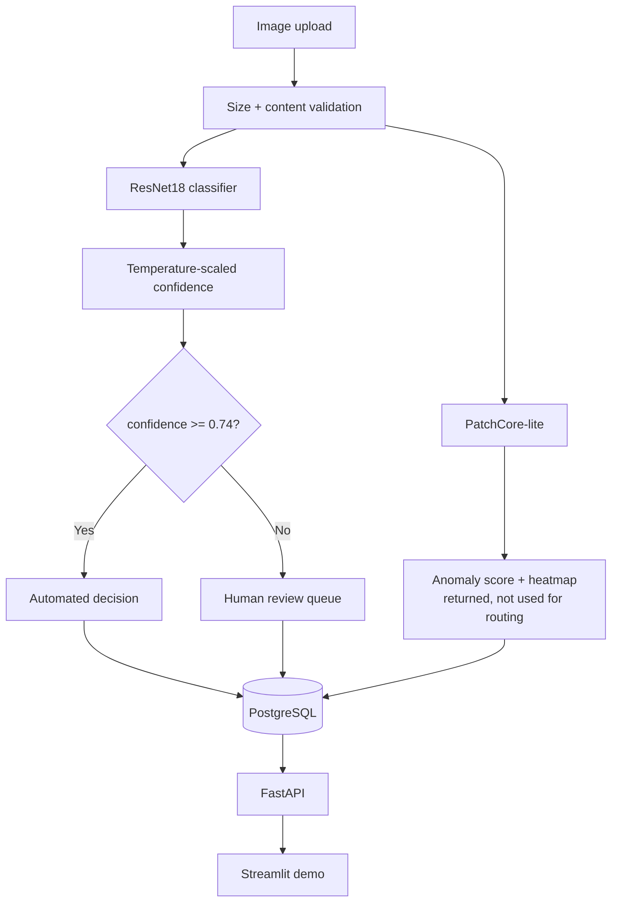

# DefectVisionAI

Surface-defect inspection prototype for manufactured parts: a PatchCore-style anomaly detector, a supervised ResNet18 classifier, calibrated confidence that routes uncertain parts to a human reviewer, and a FastAPI + PostgreSQL backend with a review workflow. A research prototype on the MVTec AD `metal_nut` benchmark, **not validated on automotive production data**.

[](https://github.com/nithya-prakash/DefectVisionAI/actions/workflows/ci.yml)  


*Recorded from the local Streamlit demo calling the API: a normal part, a defective part flagged for review, and the review endpoint. Does not show a hosted deployment, authentication, or real production images.*

## Results

| Metric | Result [95% CI] | Data | Reproduce |
|---|---|---|---|
| Anomaly detection, image AUROC (benchmark protocol) | PatchCore-lite 0.944 [0.894, 0.981]; classical baseline 0.577 [0.456, 0.698] | 115 official test images, 93 defective (base rate 0.81) | `python scripts/train_anomaly.py` |
| Defect vs good, same images, AUROC | classifier 0.985 [0.939, 1.0]; PatchCore 0.898 [0.755, 1.0]; difference −0.087 [−0.230, +0.010] | 35 held-out images, 28 defective (base rate 0.80) | `python scripts/evaluate_review_policy.py test` |
| Five-class accuracy | 0.800 [0.641, 0.900]; **`bent` recall 0.43 [0.16, 0.75]** | same 35 images, 7 per class | `python scripts/train.py` |
| Human-review policy (threshold 0.74) | 57% reviewed, 15 auto-decided, auto-accuracy 1.00 [0.80, 1.00]; out-of-fold 0.907 [0.784, 0.963] | 35 test images; 80-image pool, 5-fold CV | `python scripts/evaluate_review_policy.py validate` |
| Tests and checks | 109 tests pass; ruff, mypy and `pip check` clean | clean Linux containers, arm64 native and x86_64 emulated | `pytest` |

**Honest reading:** 35 test images (7 good) give wide intervals, so PatchCore and the classifier cannot be separated on defect detection, and "no auto-decided error" rests on 15 images. The review threshold and temperature were chosen on out-of-fold predictions from cross-validation models (accuracy 0.70, not the deployed checkpoint), frozen in `reports/metrics/review_policy_frozen.json` before the test images were scored once. Temperature calibration improved out-of-fold ECE (0.121 to 0.080), but ECE on the test images with the adopted temperature was **not measured**. About half of all images go to a person at this threshold. The 115-image benchmark and the 35-image comparison are different protocols and are not interchangeable. These checks have not run on GitHub Actions since the latest changes.

## Quickstart

```bash
python3.12 -m venv .venv && source .venv/bin/activate && pip install torch==2.14.1 torchvision==0.29.1 --index-url https://download.pytorch.org/whl/cpu && pip install -e ".[dev]" -c constraints.txt
python scripts/download_data.py && python scripts/prepare_data.py && python scripts/train_anomaly.py && python scripts/train.py
uvicorn automotive_vision.api.main:app --port 8020   # demo: API_URL=http://localhost:8020 streamlit run demo/app.py
```

| Variable | Purpose |
|---|---|
| `DATABASE_URL` | SQLAlchemy URL (default `sqlite:///./automotive_vision.db`; `docker compose up --build` uses Postgres) |
| `API_URL` | where the Streamlit demo finds the API (default `http://localhost:8000`) |

## Architecture



PyTorch, torchvision, scikit-learn, scikit-image, OpenCV, FastAPI, SQLAlchemy, PostgreSQL, Docker, GitHub Actions. The anomaly-score review gate exists in code but is disabled: on the validation pool it would send about 95% of images to review.

## Usage

```bash
curl -F "file=@part.png" localhost:8020/predict          # prediction, confidence, anomaly score, needs_human_review
curl -X POST localhost:8020/review -H "Content-Type: application/json" \
  -d '{"prediction_id": 1, "human_label": "bent", "reviewer_status": "confirmed_defect"}'
docker compose up --build    # API on :8020, Postgres on :5440 (demo-only password, see Limitations); ./data must be writable by uid 1000
```

Uploads are limited to 10 MiB per image, 16 files per batch (so a batch request can carry up to 160 MiB) and 25 million pixels; the payload is validated as PNG, JPEG or BMP whatever its declared type. There is no authentication, so this is a local demo service, not a hardened production one.

## Limitations

- MVTec AD `metal_nut` (a fastener), used as an analogue for automotive hardware: benchmark data, **not automotive production data and not an automotive validation**.
- 35 test images, 80 labeled pool images: every interval is wide; active-learning labels are simulated; active learning showed no clear advantage over random.
- The classifier's weakest class is `bent` (recall 0.43); PatchCore-lite is a simplified variant (random coreset, k=1).
- The review policy was validated on cross-validation models, not the deployed checkpoint; the anomaly gate is off.
- No authentication, rate limiting or TLS; tests do not cover training loops, Grad-CAM or the Postgres compose stack.
- **`docker-compose.yml` ships a demo-only Postgres password (`automotive`) and publishes Postgres (5440) and the API (8020) on all host interfaces.** Do not deploy with the default password or those open ports.
- Three separate licensing points. Code: MIT (this repository). MVTec AD images: CC BY-NC-SA 4.0 (non-commercial, attribution, share-alike), not redistributed here; the Hugging Face mirror's own "MIT" tag is not relied on. ResNet18 ImageNet weights (torchvision): I found no separate license for them, and whether ImageNet's non-commercial terms extend to pretrained weights is unsettled; the API Docker image bundles them, so check before publishing the image. Use here is non-commercial research.

## More

Layout: `src/automotive_vision/` (api, inference, models, training, data, database, active_learning), `scripts/`, `configs/`, `demo/`, `docker/`, `tests/`, `reports/` (tracked metric JSONs). Checks: `pip check && ruff check src scripts tests && mypy && pytest`. Dataset notes, full results, API hardening, dependency and test details: [docs/details.md](docs/details.md). Code: MIT. Data: MVTec AD (CC BY-NC-SA 4.0), fetched by `scripts/download_data.py`, not stored in the repo.
