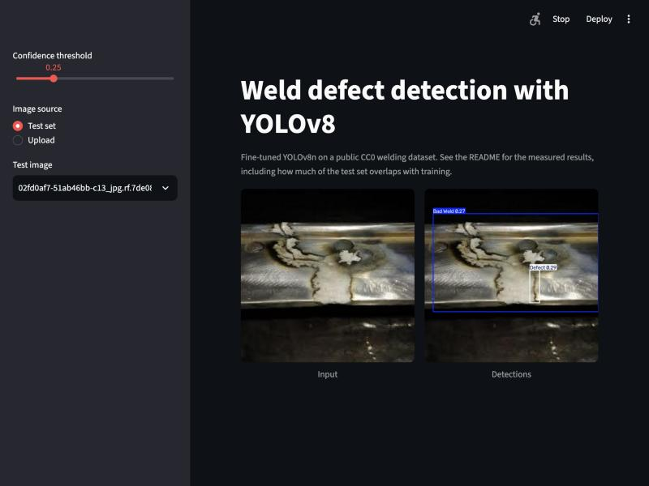

# YOLOv8 weld defect detection

A localisation experiment inside DefectVisionAI: fine-tune YOLOv8n to draw boxes around weld defects, and measure how much of the score survives once train/test overlap is accounted for.

This is **not** a head-to-head with the PatchCore-style detector in the main project. That one scores whole MVTec AD `metal_nut` images as normal or anomalous; this one detects and classifies boxes on a different dataset (welds). The two numbers are not comparable.



## Results

Held-out test split, YOLOv8n fine-tuned for 30 epochs, scored with Ultralytics' COCO-style mAP.

| Test set | Images / boxes | mAP50 | mAP50-95 | Precision | Recall |
|---|---|---|---|---|---|
| Full test split | 126 / 301 | **0.588** | 0.353 | 0.523 | 0.628 |
| Leakage-reduced subset | 71 / 210 | **0.581** | 0.322 | 0.507 | 0.650 |
| Prior-box baseline (mean box per class), full split | 126 / 301 | 0.0004 | n/a | n/a | n/a |

Per-class AP50 (Ultralytics):

| Class | Full test | Leakage-reduced |
|---|---|---|
| Bad Weld | 0.834 | 0.816 |
| Good Weld | 0.675 | 0.569 |
| Defect | **0.255** | 0.358 |

Mean inference time is about 23 ms per image on an Apple M4 (MPS), including Ultralytics preprocessing and postprocessing.

Cross-check: `welddet/boxes.py` recomputes AP@0.5 from raw predictions. Its mean is 0.549 on the full split and 0.535 on the reduced subset, below Ultralytics' 0.588 and 0.581, and per class the gap reaches 0.11 (Bad Weld, full split). Ultralytics interpolates and matches differently, but I did not pin down exactly why the two disagree, so treat the Ultralytics numbers as the reported ones and the gap as unexplained.

## The overlap problem

The dataset is a Roboflow-style export, where augmented copies of one source photo can land in different splits. A 16x16 average hash (`welddet/leakage.py`) finds, for each test image, its closest training image:

| Distance to nearest training image | Test images (of 126) |
|---|---|
| identical hash (0 bits) | 33 |
| 4 bits or fewer | 49 |
| 10 bits or fewer | 55 |

The leakage-reduced subset keeps the 71 test images more than 10 bits from any training image. Scores barely move (mAP50 0.588 to 0.581), so overlap did not obviously inflate the headline number here. The check is crude, though: a coarse hash can miss crops or colour changes and can also flag genuinely similar welds, so a clean split by source photo would be stronger. The validation split overlaps even more (112 of 283 images within 10 bits), and the checkpoint was chosen on it, so the validation mAP50 of 0.649 should not be quoted as a result.

## Method

- **Data:** [Welding Defect Object Detection](https://huggingface.co/datasets/rikkarth/welding-defect-object-detection), CC0, a mirror of a Kaggle dataset by sukmaadhiwijaya. 2,028 images (1,619 train, 283 valid, 126 test), 3 classes: Bad Weld, Good Weld, Defect. `scripts/check_data.py` validates every label row and counts boxes per class; there were no label problems.
- **Model:** YOLOv8n with COCO-pretrained weights, 3.1M parameters.
- **Training:** 30 epochs, 640 px, batch 16, Ultralytics' automatic AdamW settings, seed 0, on an Apple M4 via MPS in 1.06 hours. MPS has no fully deterministic kernels, so reruns will differ a little. The final weights are the best epoch by validation fitness (`weights/yolov8n_welding.pt`, 6.5 MB).
- **Baseline:** for every image, predict the mean training box of each class with the class frequency as score. Any real detector should beat it, and this one does by a wide margin.

## Reproduce

```bash
cd detection
uv venv --python 3.12 .venv && uv pip install --python .venv/bin/python -r requirements.txt
hf download rikkarth/welding-defect-object-detection --repo-type dataset --local-dir data/welding
.venv/bin/python scripts/check_data.py
PYTHONPATH=. .venv/bin/python scripts/check_leakage.py
.venv/bin/python scripts/train.py                       # about an hour on an M4
PYTHONPATH=. .venv/bin/python scripts/evaluate.py --weights weights/yolov8n_welding.pt
PYTHONPATH=. .venv/bin/python -m pytest tests            # 14 tests
.venv/bin/streamlit run app/demo.py
```

The download can stall on a slow connection; rerunning `hf download` resumes it.

## Limitations

- **One run, one seed, small test set.** 126 images and 301 boxes (71 and 210 in the reduced subset). No confidence intervals, so differences of a few points are not meaningful.
- **The `Defect` class is weak.** AP50 is 0.26 to 0.36, with recall only 0.34 on validation. The model finds weld regions far better than the defects inside them. The class swings by 0.10 between the full and reduced sets, which shows how noisy it is.
- **Overlap is only partly controlled** (see above): a crude hash, and the validation split used for checkpoint selection overlaps heavily.
- **Annotation quality is unknown.** The labels come from a Kaggle upload that I could not trace to a paper or a labelling protocol.
- **Not comparable to PatchCore** and not automotive production data.
- **Only YOLOv8n was trained.** No larger variant, no hyperparameter search, no augmentation study.
- **The independent AP implementation disagrees with Ultralytics** by up to 0.11 per class, for reasons I did not resolve.

## Layout

```
detection/
  welddet/boxes.py      box geometry and independent AP@0.5
  welddet/leakage.py    average-hash overlap check
  scripts/              check_data.py, check_leakage.py, train.py, evaluate.py
  app/demo.py           Streamlit demo
  tests/                14 tests
  results/              test_metrics.json, leakage_check.json, data_check.json, training_curve.csv
  weights/              yolov8n_welding.pt
```

Data is licensed CC0 by its authors. Code: MIT, like the rest of this repository. Ultralytics YOLOv8 is AGPL-3.0, so check its terms before reusing the trained weights or the training code commercially.
