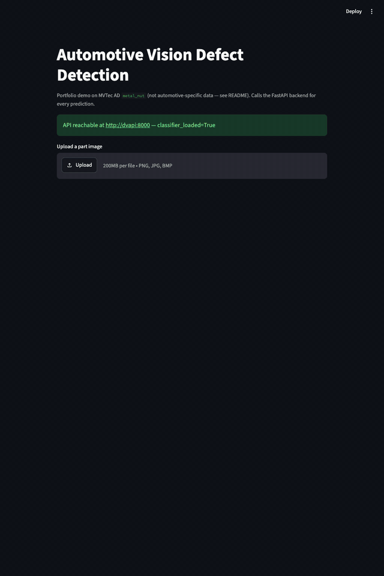
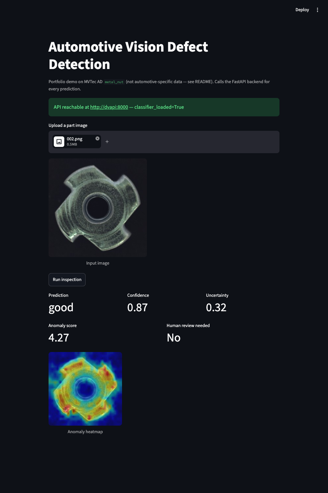
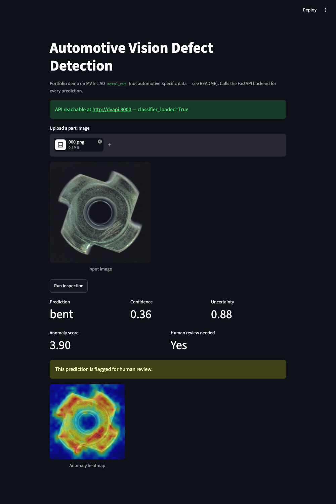
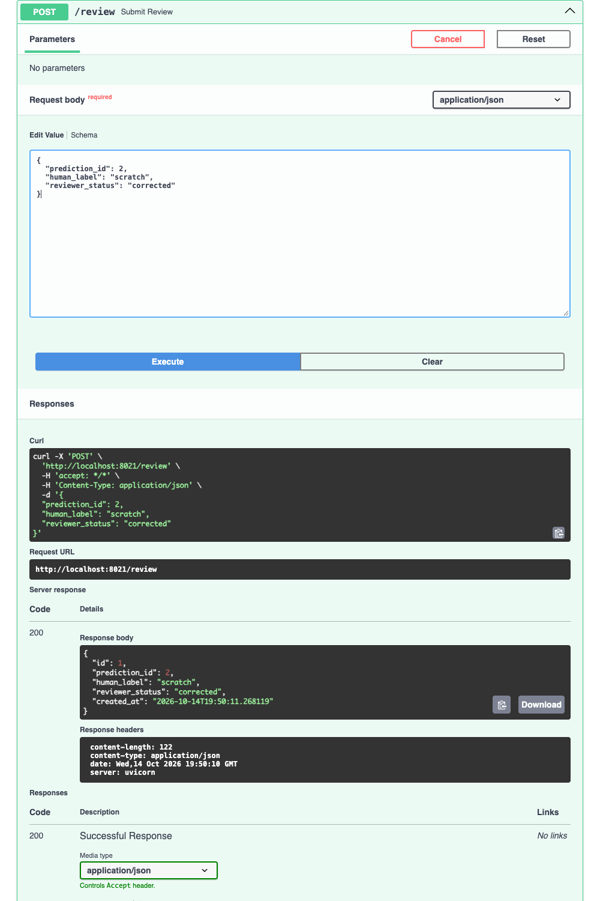
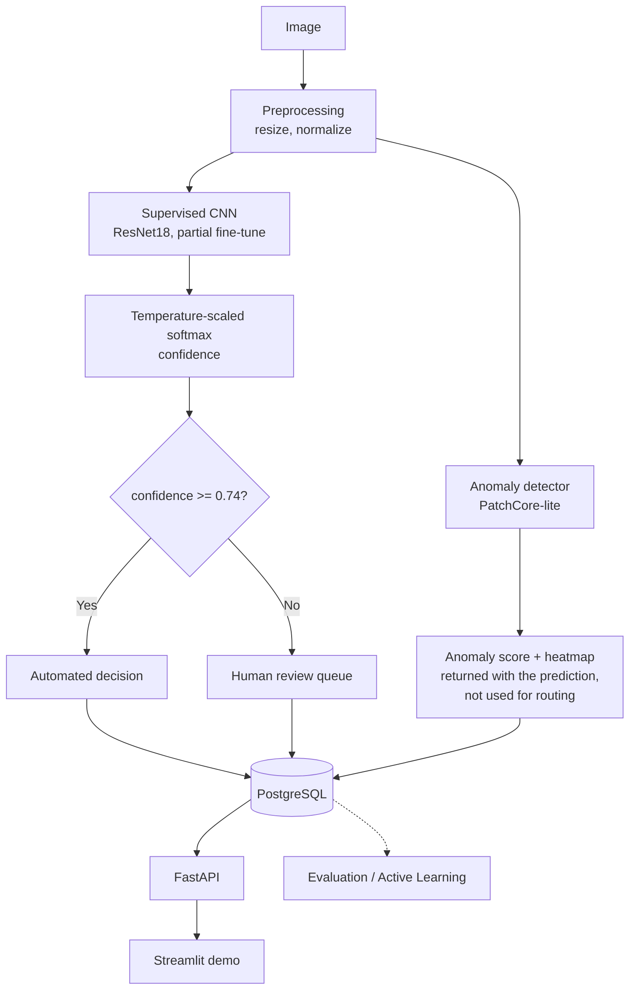

# DefectVisionAI: full details

The short README is [../README.md](../README.md). This page holds the dataset notes, full results, and the
details of the API hardening, dependency pinning and tests.

Industrial surface-defect inspection system: a classical baseline vs. a supervised
classifier vs. a PatchCore-style anomaly detector, with calibrated uncertainty
deciding when to defer to a human, an active-learning simulation testing whether
smarter sampling cuts labeling cost, and a FastAPI + PostgreSQL backend with a
human-review workflow. A research prototype on the MVTec AD benchmark, **not** validated on
automotive production data. Numbers below are read from `reports/metrics/*.json`; limitations are listed
at the end.

## Demo

```bash
API_URL=http://localhost:8020 streamlit run demo/app.py
```

A thin Streamlit UI that calls the FastAPI backend over HTTP — the API remains the
primary interface, not a parallel prediction path.



| Normal part (auto-decided) | Scratched part, misclassified as `bent` and flagged for review |
|---|---|
|  |  |

The human-review workflow itself, via the API's `/docs` Swagger UI:



## Architecture



Review routing uses the classifier's calibrated confidence only. The anomaly-score gate exists in code
(`anomaly_review_threshold`) but is **disabled**: on the validation pool it would send about 95% of images to review.

## Dataset

**MVTec AD — `metal_nut` category** (335 images: 220 normal train + 115 test = 22
good, 93 anomalous across `bent`/`color`/`flip`/`scratch`, each with a pixel-level
mask). Third-party HF mirror of the official dataset, CC BY-NC-SA 4.0. **Not
automotive production data** — `metal_nut` is used as the closest available domain
analog to automotive hardware inspection; see [`data/README.md`](../data/README.md) for
full provenance and why the supervised/active-learning track uses its own 80/35
split of the labeled pool, separate from the anomaly detector's official 220/115
protocol split.

## Key Results

Metric files in `reports/metrics/`; full report: [`reports/evaluation_report.md`](../reports/evaluation_report.md).
The test images are never used to choose a threshold or temperature: those come from five-fold cross-validation on
the 80-image labeled pool, frozen in `reports/metrics/review_policy_frozen.json` before the 35 held-out images were
scored once (`scripts/evaluate_review_policy.py`). Intervals: Wilson for proportions, class-stratified bootstrap
for AUROC/AUPRC. 35 test images (28 defective, 7 good) give wide intervals.

**1. Anomaly-detection benchmark** (official protocol: normal-only training, all 115 test images, 93 defective,
AUPRC of an uninformative scorer = 0.81; `scripts/train_anomaly.py`)

| Model | Image AUROC [95% CI] | Image AUPRC [95% CI] | Pixel AUROC |
|---|---:|---:|---:|
| Classical baseline | 0.577 [0.456, 0.698] | 0.872 [0.793, 0.931] | N/A |
| PatchCore-lite | 0.944 [0.894, 0.981] | 0.987 [0.974, 0.996] | 0.953 |

The baseline's interval includes 0.5 (chance); its AUPRC is close to the 0.81 base rate.

**2. Defect detection, same 35 held-out images** (defective vs good; AUPRC of an uninformative scorer = 0.80)

| Model | AUROC [95% CI] | AUPRC [95% CI] | Defects caught | False alarms |
|---|---:|---:|---:|---:|
| Classifier (1 − P(good)) | 0.985 [0.939, 1.000] | 0.996 [0.987, 1.000] | 27/28 | 1/7 |
| PatchCore-lite (threshold from the pool) | 0.898 [0.755, 1.000] | 0.973 [0.936, 1.000] | 24/28 | 2/7 |

Paired AUROC difference (PatchCore − classifier): −0.087, 95% interval [−0.230, +0.010], which includes 0: 35 images
cannot separate them. The models are not interchangeable: the classifier is supervised on labeled defect images from
the same distribution, PatchCore learns from normal images only. Table 1 and this table use different images and protocols.

**3. Supervised five-class classifier** (held-out test, n=35, 7 per class): accuracy 0.800 [0.641, 0.900],
macro-F1 0.794. Per-class recall [Wilson 95%]: bent **0.43 [0.16, 0.75]**, color 1.00 [0.65, 1.00], flip 1.00 [0.65, 1.00],
good 0.86 [0.49, 0.97], scratch 0.71 [0.36, 0.92]. Four of seven `bent` images were misclassified.

**4. Human-review policy** (confidence threshold 0.74 and temperature 1.457, selected out-of-fold: maximise
auto-decision coverage subject to auto-accuracy ≥ 0.90)

| | Review rate | Auto-decided | Auto-decided accuracy [Wilson 95%] |
|---|---:|---:|---:|
| Out-of-fold, 80 pool images (cross-validation models, accuracy 0.70) | 0.46 | 43 | 0.907 [0.784, 0.963] |
| Held-out test, 35 images (final checkpoint, accuracy 0.80) | 0.57 | 15 | 1.000 [0.796, 1.000] |

All seven test errors fell below the threshold and went to review. With 15 auto-decided images this shows no observed
auto-decided error, not a guaranteed rate, and more than half of the images need a human at this threshold.

**5. Calibration**: temperature scaling fit on only 16 validation images (T = 0.143) made test ECE *worse* (0.115 → 0.179).
Fit leave-one-fold-out on 80 out-of-fold predictions it improved ECE (0.121 → 0.080, T = 1.457, now applied at inference).
ECE on the test images with the new temperature was not measured.

**6. Active learning**: random/uncertainty/diversity/hybrid acquisition compared over 5 seeds
(`reports/figures/active_learning_curves.png`). Confidence bands overlap for most of the budget range — **this does
not demonstrate a clear labeling-efficiency advantage over random selection**, given the dataset's small size.

## Tech Stack

- **ML**: PyTorch + torchvision (ResNet18), scikit-learn, scikit-image, OpenCV, Pillow
- **Backend**: FastAPI, Pydantic, Uvicorn
- **Data**: SQLAlchemy + PostgreSQL (SQLite for local dev/tests), YAML-driven configs
- **Infrastructure**: Docker + Docker Compose, GitHub Actions CI
- **Testing**: pytest, ruff, mypy

## Quickstart

```bash
git clone https://github.com/nithya-prakash/DefectVisionAI.git && cd DefectVisionAI
python3.12 -m venv .venv && source .venv/bin/activate   # Python 3.12 -- PyTorch doesn't support 3.14 yet
pip install -e ".[dev]"
python scripts/download_data.py && python scripts/prepare_data.py

# Run the experiments (each writes real metrics to reports/metrics/)
python scripts/train_anomaly.py
python scripts/train.py
python scripts/evaluate.py                          # descriptive calibration; selects nothing
python scripts/evaluate_review_policy.py validate   # 5-fold CV on the pool, writes the frozen policy
python scripts/evaluate_review_policy.py test       # scores the 35 test images once, needs the frozen policy
python scripts/run_active_learning.py
python scripts/generate_report.py

python scripts/run_inference.py --image path/to/image.png   # single-image CLI inference
uvicorn automotive_vision.api.main:app --reload             # POST /predict, /review, GET /predictions/{id}, /health, /metrics
docker compose up --build                                    # API on :8020, Postgres on :5440
pytest                                                        # 52 tests, ~10s
```

Runs entirely on CPU or Apple Silicon MPS — no GPU or paid API required.

## Limitations

- Benchmark data, not automotive production data (MVTec AD `metal_nut`, a fastener).
- Human labeling in active learning is simulated with ground-truth labels, not live annotation.
- Both the supervised and active-learning tracks train on very small data (80 labeled images / 5 classes) — reported metrics have wide confidence intervals.
- Active learning, and temperature scaling fit on 16 images, produced negative/inconclusive results, reported as such.
- The review threshold and temperature come from cross-validation models (fixed 8 epochs, accuracy 0.70) that are not the
  deployed checkpoint (accuracy 0.80 on the test images); how well they transfer is only checked by 35 test images.
- Review is heavy: about half of the images are routed to a person at the validated threshold.
- 35 test images, 7 good: every interval is wide, and PatchCore and the classifier cannot be separated on defect detection.
- The anomaly-score review gate is disabled; nothing in the shipped decision logic uses PatchCore.
- ResNet18 ImageNet weights are used under torchvision's license terms, which this project has not separately verified.
- PatchCore-lite is a simplified variant (random coreset, k=1 NN), not a reproduction of the original paper.
- Grad-CAM/anomaly heatmaps are correlational, not causal proof of the defect location.

## API hardening (what it does and does not do)

- **Upload size** is limited before the body is parsed (`RequestSizeLimitMiddleware` in `api/upload_limits.py`):
  an oversize `Content-Length` is refused with 413 immediately, and a chunked or understated body is cut off while it
  streams in. Starlette otherwise buffers the whole multipart body before a route runs. Limits: 10 MiB per image,
  16 files per batch request, 25 million pixels per image. Request-body caps follow from those: 10 MiB + 64 KiB for
  `/predict` and 16 × 10 MiB + 64 KiB (about 160 MiB) for `/predict/batch`, so a batch of 16 images each just under
  10 MiB is accepted. A batch is read and validated in memory before anything is stored, so a maximal batch holds
  up to about 160 MiB at once; the body is bounded, not unbounded.
- **Content, not headers:** the declared `Content-Type` and file name are ignored. The bytes must decode as PNG, JPEG or
  BMP (400 for empty, truncated or not an image; 415 for a real image in another format such as GIF; 422 for too many pixels).
  Files are stored under their database id with the detected extension.
- **Batches are all-or-nothing:** every file is validated before any is stored.
- **Docker:** `docker/Dockerfile.api` runs as uid 1000 and bakes the ResNet18 weights into the image, so the container
  needs no network access to serve. With the compose bind mounts, `./data` must be writable by uid 1000.
- **Demo-only credential:** `docker-compose.yml` sets the Postgres user, password and database to `automotive`
  (and repeats them in `DATABASE_URL`), and publishes Postgres on host port 5440 and the API on 8020 on all interfaces.
  These defaults exist so `docker compose up` works locally; they must be changed, and the ports not published, before
  any deployment. This phase documented the risk and did not change Compose behaviour.
- **Not done:** authentication, rate limiting, TLS, audit logging. The service has not been security-reviewed and is a
  local demo, not a hardened production service. A token-authentication option was deliberately left out of this phase.

## Dependencies and CI

`constraints.txt` pins every installed package except PyTorch to the versions the tests, ruff and mypy ran with
(Python 3.12, Linux arm64 container, 2026-10-14). PyTorch is pinned separately (`torch==2.14.1`,
`torchvision==0.29.1`, CPU index) in CI and in both Dockerfiles. CI runs `pip check`, `ruff check src scripts tests`,
`mypy` (target set in `pyproject.toml`: `src`) and `pytest`. These exact steps passed in a clean `python:3.12-slim`
container on arm64 (native) and on x86_64 (emulated on an Apple-silicon host, Python 3.12.15, Debian-based image):
install with the constraints, `pip check`, ruff, mypy and all 109 tests passed in both. **They have not run on GitHub
Actions**: the runner's OS image, Python patch version and pip cache differ from those containers, so CI compatibility
of the constraints stays unverified until a workflow run uses them.

## Tests (109)

Unit and API tests run on tiny synthetic inputs with a random-weight ResNet18 (no downloads, no training):
PatchCore scoring (capped memory bank, defect scores above a held-out normal, save/load round trip, scoring before fit,
bad shapes), the classical baseline (feature shape and determinism, ordering, malformed files), classifier forward pass
and trainable-parameter flags, the predictor end to end (confidence, temperature, review routing, non-image bytes),
metric calculations against hand-computed values, upload validation and size limits (including an ASGI-level test of
streamed bodies), API error responses, and the review-policy selection and interval helpers.
Seven of the fourteen API hardening tests fail on the previous API code (the other seven check behaviour that must not regress). Not covered: the training loops, active learning
end to end, Grad-CAM, and the Docker Compose stack with Postgres.

## Evaluation evidence tracked in git

`reports/metrics/` now tracks six small JSON files (about 92 KB) so the reported numbers can be checked, including
`review_policy_frozen.json`, which was written before the 35 test images were scored. Datasets, checkpoints, uploads and
figures stay ignored. Temperature calibration: out-of-fold ECE improved (0.121 to 0.080, T = 1.457), but **ECE on the
test images with the adopted temperature has not been measured**.

## Licensing: three separate things

- **This repository's code:** MIT (`LICENSE`).
- **MVTec AD images:** CC BY-NC-SA 4.0 (non-commercial, attribution, share-alike). That is what several secondary sources
  (dataset cards, library documentation, MVTec's pages for its sibling datasets) state; I could not retrieve MVTec's own
  MVTec AD page, so the project's `data/README.md` remains the record of how the data was obtained. The images are not
  committed here. The third-party Hugging Face mirror used by `scripts/download_data.py` tags itself "MIT"; that tag is
  not relied on.
- **ResNet18 weights:** loaded from torchvision (`ResNet18_Weights.IMAGENET1K_V1`), trained on ImageNet-1K. I found no
  license attached to the torchvision weights themselves. ImageNet's access terms limit the *dataset* to non-commercial
  research and educational use; whether that extends to weights trained on it is unsettled in the sources I found
  (forum discussions, no authoritative answer), and I am not asserting either way. I did not read torchvision's current
  documentation line by line. `docker/Dockerfile.api` bakes these weights into the image, so the image should not be
  published or redistributed without checking.

This project is a non-commercial research prototype on a benchmark dataset, not an automotive validation.
